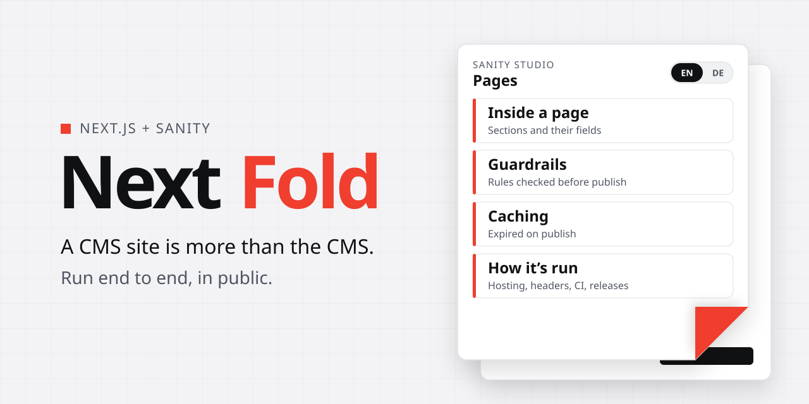

<p align="center">
  <picture>
    <source media="(prefers-color-scheme: dark)" srcset=".github/brand/readme-dark.svg" />
    
  </picture>
</p>

# Next Fold

[](./LICENSE)
[](https://nodejs.org/)
[](https://nextjs.org/)
[](https://react.dev/)
[](https://www.typescriptlang.org/)
[](https://www.sanity.io/)

A [Next.js](https://nextjs.org/) App Router and [Sanity](https://www.sanity.io/) demo. Editors build marketing pages from typed sections in Sanity Studio, embedded in the app. Developers own the schema, the GROQ queries, and the React components.

## Explore the demo

Live demo: **[nextfold.marcopontili.com](https://nextfold.marcopontili.com)**

| Page | What it shows |
| --- | --- |
| [Home](https://nextfold.marcopontili.com/) | What editors and developers each own |
| [Anatomy of a page](https://nextfold.marcopontili.com/anatomy) | Each section next to the Sanity data it came from |
| [Guardrails](https://nextfold.marcopontili.com/guardrails) | The schema rules that keep pages on brand |
| [For agents](https://nextfold.marcopontili.com/for-agents) | Markdown versions, `llms.txt`, sitemap |

## How content flows

<picture>
  <source media="(prefers-color-scheme: dark)" srcset="docs/content-flow-dark.svg" />
  
</picture>

[Architecture](docs/architecture.md) follows a request through the code.

## What it shows

| Area | Where |
| --- | --- |
| A page is an ordered list of typed sections | [`src/sanity/schemaTypes/`](src/sanity/schemaTypes/) |
| Field validation and Studio previews per section | [`sections.ts`](src/sanity/schemaTypes/sections.ts) |
| One React component per section type | [`SectionRenderer.tsx`](src/components/SectionRenderer.tsx) |
| GROQ through the Sanity CDN, refreshed every 60 seconds | [`queries.ts`](src/sanity/lib/queries.ts), [`fetch-page.ts`](src/sanity/lib/fetch-page.ts) |
| Sanity Studio at `/studio` | [`sanity.config.ts`](sanity.config.ts) |
| Markdown version of every page, `llms.txt`, sitemap, JSON-LD | [`src/proxy.ts`](src/proxy.ts), [`src/app/`](src/app/) |

## Quick start

Requires Node.js 22.13+.

```bash
npm install
cp .env.example .env
npm run dev
```

Open http://localhost:3100. Without `NEXT_PUBLIC_SANITY_PROJECT_ID`, the bundled seed pages render; [Sanity setup](docs/sanity-setup.md) connects your own project.

## Environment

| Variable | Used for | Default |
| --- | --- | --- |
| `NEXT_PUBLIC_SANITY_PROJECT_ID` | Sanity content and the Studio | Empty: sample content only |
| `NEXT_PUBLIC_SANITY_DATASET` | Sanity content and the Studio | `production` |
| `SANITY_API_READ_TOKEN` | Draft previews (planned) | Empty |
| `NEXT_PUBLIC_SITE_URL` | Canonical URLs, sitemap, JSON-LD | `https://nextfold.marcopontili.com` |
| `NEXT_PUBLIC_MATOMO_SITE_ID`, `NEXT_PUBLIC_MATOMO_CONTAINER_ID` | Cookieless analytics | Empty: no tracking |

<details>
<summary>Commands</summary>

| Command | Purpose |
| --- | --- |
| `npm run dev` | Dev server on port 3100 |
| `npm run lint` | ESLint |
| `npm run typecheck` | TypeScript, no output files |
| `npm run build` | Production build |
| `npm start` | Serve the production build on port 3100 |

</details>

## Documentation

| Guide | What it answers |
| --- | --- |
| [Sanity setup](docs/sanity-setup.md) | Free plan limits, project, dataset, CORS, first page |
| [Architecture](docs/architecture.md) | Content model, request path, Markdown and discovery routes |

## Tech stack

| Layer | Tools |
| --- | --- |
| Framework | Next.js 16 App Router, React 19, TypeScript 5 |
| Styling | Plain CSS with cascade layers, custom properties, and `light-dark()`; Inter through `next/font` |
| Content | Sanity Studio 6 embedded at `/studio`, `next-sanity`, GROQ over the Sanity CDN |
| Hosting | Vercel, production built from `main` |
| DNS | Cloudflare, `nextfold` CNAME, DNS only |
| Analytics | Self-hosted Matomo, cookieless |
| Quality | ESLint, TypeScript |

## Related

[Next Story](https://github.com/marcop135/nextstory) is the Storyblok counterpart: localization, draft preview, webhook cache refresh, and read-only agent tools.

## Author

[Marco Pontili](https://marcopontili.com)

## License

[MIT](./LICENSE)
