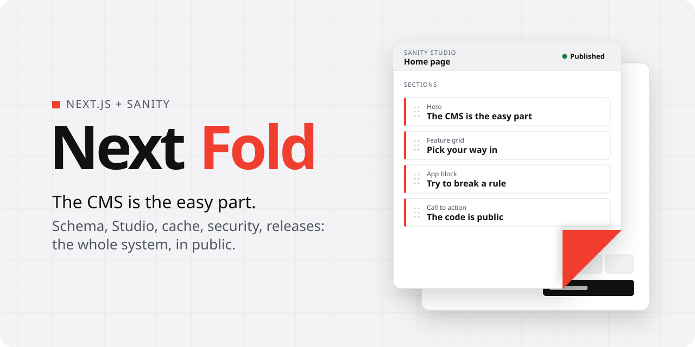

<p align="center">
  <a href="https://nextfold.marcopontili.com">
    <picture>
      <source media="(prefers-color-scheme: dark)" srcset=".github/brand/readme-dark-rounded.svg" />
      
    </picture>
  </a>
</p>

# Next Fold

[](https://github.com/marcop135/nextfold/actions/workflows/ci.yml)
[](https://github.com/marcop135/nextfold/releases/latest)
[](./LICENSE)
[](https://nodejs.org/)
[](https://nextjs.org/)
[](https://react.dev/)
[](https://www.sanity.io/)

**A CMS site is more than the CMS.** Next Fold is a [Next.js](https://nextjs.org/) and [Sanity CMS](https://www.sanity.io/) demo that runs the rest in public: guardrails, caching, i18n, security, CI, and releases.

Every page shows one part working and links to its code. **Editors** fill typed sections in [Studio](https://nextfold.marcopontili.com/studio); **developers** own the schema, queries, and components.

## Explore the demo

Live demo: **[nextfold.marcopontili.com](https://nextfold.marcopontili.com)**

| Page | What it shows |
| --- | --- |
| [Home](https://nextfold.marcopontili.com/) | Three ways in, and the page's own sections as an editor sees them in the Studio |
| [Inside a page](https://nextfold.marcopontili.com/inside-a-page) | How a page gets built, and its sections as a sketch: pick one to see the fields an editor filled in |
| [Guardrails](https://nextfold.marcopontili.com/guardrails) | The rules the Studio checks before a page can publish, and a playground to break them |
| [Caching](https://nextfold.marcopontili.com/caching) | When this page entered the cache, what expires it, and the headers of a fresh request |
| [How it's run](https://nextfold.marcopontili.com/system) | Hosting, DNS, security headers, analytics, CI, and the release flow, with a link to check each |
| [For agents](https://nextfold.marcopontili.com/for-agents) | Markdown versions, `llms.txt`, sitemap |

Every page also exists in German under [`/de`](https://nextfold.marcopontili.com/de).

## How content flows

<picture>
  <source media="(prefers-color-scheme: dark)" srcset="docs/content-flow-dark.svg" />
  
</picture>

[Architecture](docs/architecture.md) follows a request through the code. Every page is listed in the [docs index](docs/README.md).

## Tech stack

| Layer | Tools |
| --- | --- |
| Framework | Next.js 16 App Router, React 19, TypeScript 5 |
| Styling | Plain CSS with cascade layers and `light-dark()` |
| Content | Sanity Studio 6, GROQ, Visual Editing, English and German |
| Caching | Next.js Cache Components, expired on publish |
| Quality | ESLint, Sanity TypeGen, GitHub Actions CI, Dependabot |
| Security | Security headers, CodeQL, OpenSSF Scorecard |
| Analytics | Self-hosted Matomo, cookieless |
| Hosting | Vercel, Cloudflare DNS |

## Quick start

Requires Node.js 22+.

```bash
npm install
cp .env.example .env
npm run dev
```

Open http://localhost:3100. Without `NEXT_PUBLIC_SANITY_PROJECT_ID`, the bundled seed pages render.

| Command | Purpose |
| --- | --- |
| `npm run dev` | Dev server on port 3100 |
| `npm run lint` | ESLint |
| `npm run typecheck` | TypeScript, no output files |
| `npm run build` | Production build |
| `npm start` | Serve the production build on port 3100 |
| `npm run typegen` | Regenerate the Sanity schema and types after a schema or query change |
| `npm run seed:import` | Copy the seed pages and site settings into your Sanity dataset |

## Sanity setup

Create a project and dataset, add the CORS origin, and publish a first page with [Sanity setup](docs/sanity-setup.md).

All variables are optional in local mode. Set them in `.env` to load content from Sanity:

| Variable | Used for | Default |
| --- | --- | --- |
| `NEXT_PUBLIC_SANITY_PROJECT_ID` | Sanity content and the Studio | Empty: sample content only |
| `NEXT_PUBLIC_SANITY_DATASET` | Sanity content and the Studio | `production` |
| `SANITY_API_READ_TOKEN` | Draft mode, Presentation, and Visual Editing | Empty: published content only |
| `SANITY_REVALIDATE_SECRET` | Publish webhook at `/api/revalidate` | Empty: the webhook answers 501 |
| `NEXT_PUBLIC_SITE_URL` | Canonical URLs, sitemap, JSON-LD | `https://nextfold.marcopontili.com` |
| `NEXT_PUBLIC_MATOMO_SITE_ID`, `NEXT_PUBLIC_MATOMO_CONTAINER_ID` | Cookieless analytics | Empty: no tracking |

## Contributing

Found a bug or have an idea? [Open an issue](https://github.com/marcop135/nextfold/issues/new/choose), or read the [contributing guide](.github/CONTRIBUTING.md) before a pull request. To report a vulnerability, use [private reporting](.github/SECURITY.md) instead of a public issue.

## Author

[Marco Pontili](https://marcopontili.com)

## License

[MIT](./LICENSE)
