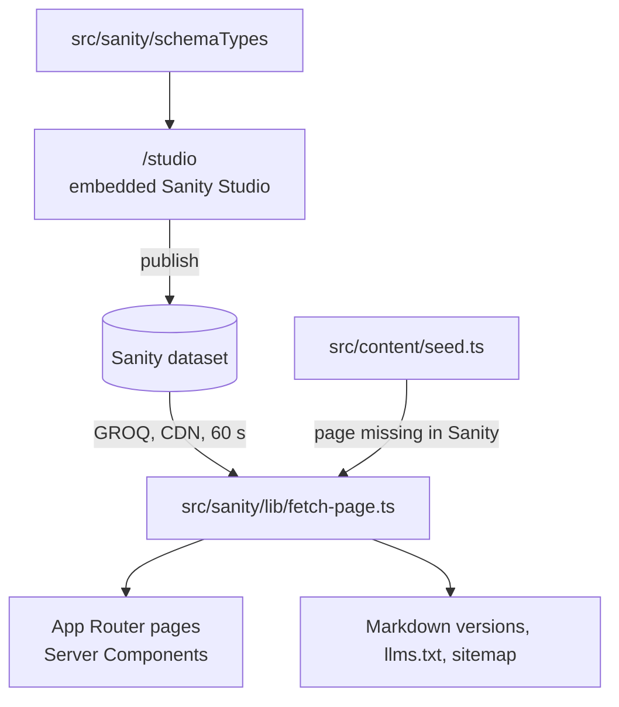

# Architecture

## Content model

| Type | Kind | Fields |
| --- | --- | --- |
| `page` | Document | `title`, `slug`, `description` (70 to 160 characters), `sections` |
| `hero` | Section | `eyebrow`, `heading`, `body`, `cta` |
| `featureGrid` | Section | `heading`, `items` (2 to 6 of `title`, `body`) |
| `steps` | Section | `heading`, `items` (2 to 8 of `title`, `body`) |
| `codeSample` | Section | `heading`, `body`, `filename`, `language` (`json`, `ts`, `groq`, `bash`), `code` |
| `callToAction` | Section | `heading`, `body`, `link` |
| `link` | Object | `label`, `href` (starts with `/` or `https://`) |

A page is an ordered list of sections. Each section type has one schema in [`sections.ts`](../src/sanity/schemaTypes/sections.ts) and one component in [`SectionRenderer.tsx`](../src/components/SectionRenderer.tsx). The TypeScript shapes in [`types.ts`](../src/sanity/types.ts) are written by hand for now.

## Request path

1. [`src/proxy.ts`](../src/proxy.ts) runs first. It rewrites `/index.md` and `/<slug>.md` to the Markdown route, and answers a page request that prefers `text/markdown` with Markdown. HTML responses carry a `Link` header to their Markdown version. A request that accepts neither type gets 406.
2. [`(site)/page.tsx`](../src/app/(site)/page.tsx) loads the page with slug `home`. [`[slug]/page.tsx`](../src/app/(site)/[slug]/page.tsx) loads every other slug and returns 404 for `/home`.
3. [`fetch-page.ts`](../src/sanity/lib/fetch-page.ts) reads published content through the Sanity CDN with [`PAGE_QUERY`](../src/sanity/lib/queries.ts), tagged `page` and refreshed every 60 seconds. When there is no project ID, or Sanity has no page with that slug, it returns the seed page instead. The line under each page names the source.
4. [`PageView`](../src/components/PageView.tsx) renders the sections and the page's JSON-LD. A leading Hero holds the page `h1`; otherwise the page title does.
5. [`studio/[[...tool]]/page.tsx`](../src/app/studio/[[...tool]]/page.tsx) mounts the Studio from [`sanity.config.ts`](../sanity.config.ts) outside the site layout. Without a project ID it shows setup steps.

## Search and agent discovery

| Route | Source | Notes |
| --- | --- | --- |
| `/<path>.md`, `/index.md` | [`md/[slug]/route.ts`](../src/app/md/[slug]/route.ts) | Same content as the HTML page, with YAML front matter and a canonical `Link` header |
| `/llms.txt` | [`llms.txt/route.ts`](../src/app/llms.txt/route.ts) | Every page with its Markdown link and description |
| `/sitemap.xml` | [`sitemap.ts`](../src/app/sitemap.ts) | `lastmod` from Sanity's `_updatedAt`; seed and fixed pages have none |
| `/robots.txt` | [`robots.txt/route.ts`](../src/app/robots.txt/route.ts) | `Content-Signal: search=yes, ai-input=yes`, blocks `/studio`; Vercel previews block everything |
| `/for-agents`, `/privacy` | [`static-pages.ts`](../src/content/static-pages.ts) | One data source renders both the HTML and the Markdown version |

[`site.ts`](../src/lib/site.ts) builds the canonical URLs, Open Graph tags, and the JSON-LD graph (`WebSite`, `Person`, `WebPage`, and `BreadcrumbList` below the home page). Vercel preview deployments get `noindex`.

## Analytics and headers

- [`Analytics.tsx`](../src/components/Analytics.tsx) loads a self-hosted, cookieless Matomo Tag Manager container. [`MatomoRouteTracker`](../src/components/MatomoRouteTracker.tsx) records client-side navigation. Both stay off until `NEXT_PUBLIC_MATOMO_SITE_ID` and `NEXT_PUBLIC_MATOMO_CONTAINER_ID` are set.
- The proxy reports page fetches by AI assistants (`ChatGPT-User`, `Claude-User`, and others) to Matomo from the server, without changing the response.
- [`next.config.ts`](../next.config.ts) sets CSP, HSTS, `nosniff`, Referrer-Policy, and `No-Vary-Search` on site routes. `/studio` gets `X-Frame-Options: SAMEORIGIN` and `noindex` instead of the CSP, because the Studio calls the Sanity APIs from the browser.
