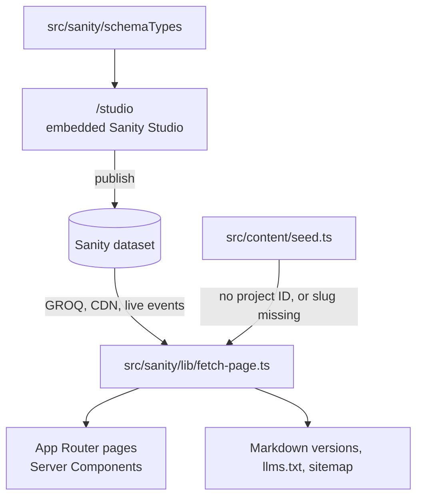

# Architecture

## Content model

| Type | Kind | Fields |
| --- | --- | --- |
| `page` | Document | `title`, `slug`, `description` (70 to 160 characters), `sections` |
| `siteSettings` | Document, one only | `nav` (1 to 5 links), `footerNote`, `projectLinks`, `siteInfoLinks` |
| `hero` | Section | `eyebrow`, `heading`, `body`, `cta` |
| `featureGrid` | Section | `heading`, `items` (2 to 6 of `title`, `body`) |
| `steps` | Section | `heading`, `items` (2 to 8 of `title`, `body`) |
| `codeSample` | Section | `heading`, `body`, `filename`, `language` (`json`, `ts`, `groq`, `bash`), `code` |
| `callToAction` | Section | `heading`, `body`, `link` |
| `link` | Object | `label`, `href` (starts with `/` or `https://`) |

A page is an ordered list of sections. Each section type has one schema in [`sections.ts`](../src/sanity/schemaTypes/sections.ts) and one component in [`SectionRenderer.tsx`](../src/components/SectionRenderer.tsx).

Sanity TypeGen writes the TypeScript types to [`sanity.types.ts`](../src/sanity/sanity.types.ts) from the extracted [`schema.json`](../src/sanity/schema.json) and the GROQ queries; [`types.ts`](../src/sanity/types.ts) gives them app-facing names. After a schema or query change, run `npm run typegen` and commit both files. CI regenerates them and fails when the committed output differs.

## Studio desk

[`structure.ts`](../src/sanity/structure.ts) lists **Site settings** first, then **Pages**. Site settings is one document with the ID `siteSettings`: it is missing from the New document menu and has no delete, duplicate, or unpublish action. The header and footer read it through `getSiteSettings` in [`fetch-page.ts`](../src/sanity/lib/fetch-page.ts), with the seed settings from [`seed.ts`](../src/content/seed.ts) until it is published.

## Request path

1. [`src/proxy.ts`](../src/proxy.ts) runs first. It rewrites `/index.md` and `/<slug>.md` to the Markdown route, and answers a page request that prefers `text/markdown` with Markdown. HTML responses carry a `Link` header to their Markdown version. A request that accepts neither type gets 406.
2. [`(site)/page.tsx`](../src/app/(site)/page.tsx) loads the page with slug `home`. [`[slug]/page.tsx`](../src/app/(site)/[slug]/page.tsx) loads every other slug and returns 404 for `/home`.
3. [`fetch-page.ts`](../src/sanity/lib/fetch-page.ts) reads content with `sanityFetch` from [`live.ts`](../src/sanity/lib/live.ts) and [`PAGE_QUERY`](../src/sanity/lib/queries.ts). Results are cached under sync tags; `<SanityLive />` in the site layout listens to the Live Content API and revalidates those tags when a document changes. In draft mode the same fetch reads drafts with the viewer token and adds stega for Visual Editing; Markdown, `llms.txt`, the sitemap, and static params always read published content. When there is no project ID, or Sanity has no page with that slug, it returns the seed page instead. The `Content source:` line above the footer names the source.
4. [`PageView`](../src/components/PageView.tsx) renders the sections and the page's JSON-LD. A leading Hero holds the page `h1`; otherwise the page title does. On the home page, the leading Hero also gets the animated [`HeroVisual`](../src/components/HeroVisual.tsx).
5. [`SiteChrome`](../src/components/SiteChrome.tsx) wraps every site page in the header and footer. The header, [`SiteHeader`](../src/components/SiteHeader.tsx), is the only client component in the chrome: it holds the small-screen menu.
6. [`studio/[[...tool]]/page.tsx`](../src/app/studio/[[...tool]]/page.tsx) mounts the Studio from [`sanity.config.ts`](../sanity.config.ts) outside the site layout. Without a project ID it shows setup steps. The Presentation tool loads the site through [`/api/draft-mode/enable`](../src/app/api/draft-mode/enable/route.ts) and maps URLs to documents in [`presentation.ts`](../src/sanity/presentation.ts).

## Search and agent discovery

| Route | Source | Notes |
| --- | --- | --- |
| `/<path>.md`, `/index.md` | [`md/[slug]/route.ts`](../src/app/md/[slug]/route.ts) | Same content as the HTML page, with YAML front matter and a canonical `Link` header |
| `/llms.txt` | [`llms.txt/route.ts`](../src/app/llms.txt/route.ts) | Every page with its Markdown link and description |
| `/sitemap.xml` | [`sitemap.ts`](../src/app/sitemap.ts) | `lastmod` from Sanity's `_updatedAt`; seed and fixed pages have none |
| `/robots.txt` | [`robots.txt/route.ts`](../src/app/robots.txt/route.ts) | `Content-Signal: search=yes, ai-input=yes`, blocks `/studio`; Vercel previews block everything |
| `/for-agents`, `/privacy` | [`static-pages.ts`](../src/content/static-pages.ts) | One data source renders both the HTML and the Markdown version |

[`site.ts`](../src/lib/site.ts) builds the canonical URLs, Open Graph tags, and the JSON-LD graph (`WebSite`, `Person`, `WebPage`, and `BreadcrumbList` below the home page). Vercel preview deployments get `noindex`.

## Analytics and headers

- [`Analytics.tsx`](../src/components/Analytics.tsx) loads a self-hosted, cookieless Matomo Tag Manager container. [`MatomoRouteTracker`](../src/components/MatomoRouteTracker.tsx) records client-side navigation. Both stay off until `NEXT_PUBLIC_MATOMO_SITE_ID` and `NEXT_PUBLIC_MATOMO_CONTAINER_ID` are set.
- The proxy reports page fetches by AI assistants (`ChatGPT-User`, `Claude-User`, and others) to Matomo from the server, without changing the response.
- [`next.config.ts`](../next.config.ts) sets CSP, HSTS, `nosniff`, Referrer-Policy, and `No-Vary-Search` on site routes. `/studio` gets `X-Frame-Options: SAMEORIGIN` and `noindex` instead of the CSP, because the Studio calls the Sanity APIs from the browser.
- The same file redirects `/anatomy` and `/anatomy.md` to `/inside-a-page` and `/inside-a-page.md` with a permanent redirect (308), so links to the page's old name keep working.
