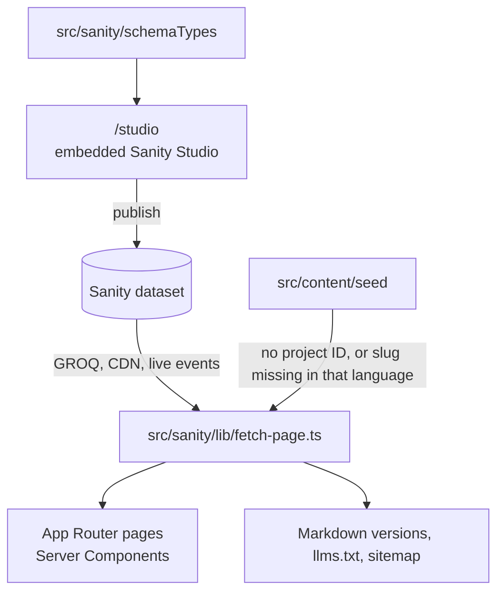

# Architecture

## Content model

| Type | Kind | Fields |
| --- | --- | --- |
| `page` | Document, one per language | `language`, `title`, `slug` (unique within its language), `description` (70 to 160 characters), `sections` |
| `siteSettings` | Document, one per language | `language`, `nav` (1 to 5 links), `footerNote`, `projectLinks`, `siteInfoLinks` |
| `hero` | Section | `eyebrow`, `heading`, `body`, `link`, `image` (hotspot and crop, alt text required once an image is set) |
| `featureGrid` | Section | `heading`, `items` (2 to 6 of `title`, `body`, optional `link`) |
| `steps` | Section | `heading`, `items` (2 to 8 of `title`, `body`) |
| `codeSample` | Section | `heading`, `body`, `filename`, `language` (`json`, `ts`, `groq`, `bash`), `code` |
| `appBlock` | Section | `heading`, `body`, `kind` (`guardrailsPlayground` or `cacheInspector`): an interactive widget built in code |
| `callToAction` | Section | `heading`, `body`, `link` |
| `link` | Object | `label`, `href` (starts with `/` or `https://`) |

Every section except `callToAction` takes a `theme` (`bg`, `surface`, `band`), and every section takes a `spacing` (`space-3`, `space-4`, `space-5`). The values are the custom property names in [`globals.css`](../src/app/globals.css), listed once in [`design-tokens.ts`](../src/lib/design-tokens.ts) for the schema; the CSS has one rule per value.

A page is an ordered list of sections. Each section type has one schema in [`sections.ts`](../src/sanity/schemaTypes/sections.ts) and one component in [`SectionRenderer.tsx`](../src/components/SectionRenderer.tsx). App blocks list their widgets in [`app-blocks.ts`](../src/lib/app-blocks.ts), with the text Markdown readers get instead; the widgets live in [`components/app-blocks`](../src/components/app-blocks).

Every text limit and its message lives in [`rules.ts`](../src/lib/rules.ts). The schema reads it through [`text-rules.ts`](../src/sanity/schemaTypes/text-rules.ts), the Guardrails playground reads it in the browser, and `npm run content:check` ([`content-check.mjs`](../scripts/content-check.mjs)) checks the seed copy in every language against it in CI.

Sanity TypeGen writes the TypeScript types to [`sanity.types.ts`](../src/sanity/sanity.types.ts) from the extracted [`schema.json`](../src/sanity/schema.json) and the GROQ queries; [`types.ts`](../src/sanity/types.ts) gives them app-facing names. After a schema or query change, run `npm run typegen` and commit both files. CI regenerates them and fails when the committed output differs.

## Studio desk

[`structure.ts`](../src/sanity/structure.ts) lists **Site settings** first, one document per language (`siteSettings`, `siteSettings-de`), then **Pages** per language. Settings are missing from the New document menu and have no delete, duplicate, or unpublish action. New pages start from the **Page, English** or **Page, Deutsch** template, which sets the language for good. The header and footer read the settings through `getSiteSettings` in [`fetch-page.ts`](../src/sanity/lib/fetch-page.ts), with the seed settings from [`src/content/seed`](../src/content/seed) until they are published. [Add a language](i18n.md) covers the rest.

## Request path

1. [`src/proxy.ts`](../src/proxy.ts) runs first. It redirects `/en/...` to the unprefixed URL, rewrites `/<slug>` to `/en/<slug>` internally, and leaves `/de/<slug>` as it is. It rewrites `/index.md`, `/<slug>.md`, and their `/de` versions to the Markdown route, and answers a page request that prefers `text/markdown` with Markdown. HTML responses carry a `Link` header to their Markdown version. A request that accepts neither type gets 406.
2. [`[locale]/layout.tsx`](../src/app/[locale]/layout.tsx) is the root layout for each language: it sets `<html lang>`, wraps the page in [`SiteChrome`](../src/components/SiteChrome.tsx), and mounts `<SanityLive />` and, in draft mode, Visual Editing. [`(site)/page.tsx`](../src/app/[locale]/(site)/page.tsx) loads the page with slug `home`; [`[slug]/page.tsx`](../src/app/[locale]/(site)/[slug]/page.tsx) loads every other slug and returns 404 for `/home`.
3. [`fetch-page.ts`](../src/sanity/lib/fetch-page.ts) reads content inside `'use cache'` boundaries with `sanityFetch` from [`live.ts`](../src/sanity/lib/live.ts) and [`PAGE_QUERY`](../src/sanity/lib/queries.ts). It tries Sanity in the page's language, the seed copy in that language, then English. Draft mode is resolved outside the cache and passed in, so drafts and published content never share an entry. [Caching](caching.md) explains the tags and what expires them. The line above the footer names the source.
4. [`PageView`](../src/components/PageView.tsx) renders the sections and the page's JSON-LD. A leading Hero holds the page `h1`; otherwise the page title does. On the home page, the leading Hero also gets [`HeroVisual`](../src/components/HeroVisual.tsx): the page's own sections as Studio rows next to the blocks the site renders from them, which visitors can reorder once the intro has played.
5. [`SiteChrome`](../src/components/SiteChrome.tsx) renders the header and footer from the settings in the page's language. The header, [`SiteHeader`](../src/components/SiteHeader.tsx), is a client component: it holds the small-screen menu and the language switch, whose links load a full page because each language has its own root layout.
6. [`studio/[[...tool]]/page.tsx`](../src/app/studio/[[...tool]]/page.tsx) mounts the Studio from [`sanity.config.ts`](../sanity.config.ts) under its own root layout. Without a project ID it shows setup steps. The Presentation tool loads the site through [`/api/draft-mode/enable`](../src/app/api/draft-mode/enable/route.ts) and maps URLs, `/de` included, to documents in [`presentation.ts`](../src/sanity/presentation.ts).

## Search and agent discovery

| Route | Source | Notes |
| --- | --- | --- |
| `/<path>.md`, `/index.md`, `/de/<path>.md`, `/de/index.md` | [`md/[locale]/[slug]/route.ts`](../src/app/md/[locale]/[slug]/route.ts) | Same content as the HTML page, with YAML front matter (`lang` included), `Content-Language`, a canonical `Link`, and the other language's twin |
| `/llms.txt` | [`llms.txt/route.ts`](../src/app/llms.txt/route.ts) | Every page with its Markdown link and description, one section per language |
| `/sitemap.xml` | [`sitemap.ts`](../src/app/sitemap.ts) | One URL per page and language with `hreflang` alternates; `lastmod` from Sanity's `_updatedAt`, none for seed and fixed pages |
| `/robots.txt` | [`robots.txt/route.ts`](../src/app/robots.txt/route.ts) | `Content-Signal: search=yes, ai-input=yes`, blocks `/studio`; Vercel previews block everything |
| `/og/<slug>`, `/og/de/<slug>` | [`og/[slug]/route.tsx`](../src/app/og/[slug]/route.tsx), [`og/de/[slug]/route.tsx`](../src/app/og/de/[slug]/route.tsx) | 1200 × 630 Open Graph card per page and language: the hero's eyebrow and heading, then the meta description |
| `/for-agents`, `/privacy`, and their `/de` versions | [`static-pages.ts`](../src/content/static-pages.ts) | One data source per language renders both the HTML and the Markdown version |

[`site.ts`](../src/lib/site.ts) builds the canonical URLs, `hreflang` alternates (`en`, `de`, `x-default`), Open Graph and X card tags with `og:locale` pointing at each page's card, and the JSON-LD graph (`WebSite`, `Person`, `WebPage` with `inLanguage`, and `BreadcrumbList` below the home page). Vercel preview deployments get `noindex`.

## Analytics and headers

- [`Analytics.tsx`](../src/components/Analytics.tsx) loads a self-hosted, cookieless Matomo Tag Manager container. [`MatomoRouteTracker`](../src/components/MatomoRouteTracker.tsx) records client-side navigation. Both stay off until `NEXT_PUBLIC_MATOMO_SITE_ID` and `NEXT_PUBLIC_MATOMO_CONTAINER_ID` are set. The container's Matomo configuration has Do Not Track off, so visits with Do Not Track or Global Privacy Control are counted, as the privacy page states; [`gpc.json`](../public/.well-known/gpc.json) declares GPC support.
- The proxy reports page fetches by AI assistants (`ChatGPT-User`, `Claude-User`, and others) to Matomo from the server, without changing the response.
- [`next.config.ts`](../next.config.ts) sets the security headers listed in [Security](security.md) and `No-Vary-Search` on site routes. `/studio` gets `noindex` and no CSP, because the Studio calls the Sanity APIs from the browser.
- The same file redirects `/anatomy` and `/anatomy.md` to `/inside-a-page` and `/inside-a-page.md` with a permanent redirect (308), so links to the page's old name keep working.
